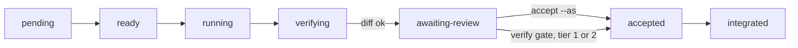
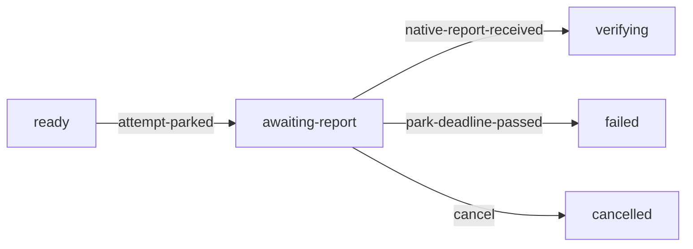

# Execution lifecycle

Accepted with ADR 0005. Plan-level states (`AwaitingPlanReview` / `PlanAccepted` /
`PlanDeclined`) are the ADR 0009 gate, implemented as `meshloop:review-plan`.

## Task states

`pending → ready → running → verifying → awaiting-review → accepted → integrated`.
Side states: `failed`, `cancelled`, `blocked`.

Per-node states (plan gate is the section below):

| From | To | Trigger | Precondition |
|---|---|---|---|
| pending | ready | dependency-satisfied event | all upstream task nodes reached `integrated`; scope authorization still valid |
| pending | blocked | dependency-failed or scope-revoked event | an upstream task reached `failed`/`cancelled`, or authorization was withdrawn |
| ready | running | attempt-started event | concurrency budget available (ADR 0009); harness capability confirmed (ADR 0003) |
| running | verifying | harness-exited event | exit code recorded; harness exit success alone never satisfies the later `accepted` precondition |
| running | failed | harness-crashed or timeout event | owned process tree confirmed terminated (Herdr: pane/agent gone — not `agent_prompt_stalled`) |
| failed | failed | harness-exited event | late exit after the attempt was already failed; the task stays failed and the event is stored |
| failed | verifying | live-worker-settled event | Failed was premature; the same attempt's Herdr pane settled; harvest that worktree |
| blocked | pending | dependency-cleared event | no upstream remains Failed/Cancelled/Blocked |
| running | cancelled | user/operator cancel event | owned process tree confirmed terminated |
| verifying | awaiting-review | deterministic-checks-passed event | DeterministicEvidence bound to exact candidate revision (ADR 0007) |
| verifying | failed | deterministic-checks-failed event | failure evidence retained, redacted (ADR 0007) |
| awaiting-review | accepted | model-review-passed (Tier 1/2, policy-eligible) or human-acceptance-recorded (Tier 3, always) event | evidence contract satisfied (ADR 0007); Tier 3 never transitions on model review alone |
| awaiting-review | accepted | verify-gate-passed event | node gate is verify and tier is explicit Tier1 or Tier2, after deterministic checks passed (ADR 0037); not model review |
| awaiting-review | failed | review-rejected event | rejection reason retained |
| accepted | integrated | integration-owner-merge event | single integration owner (ADR 0005); base revision still current |
| accepted | failed | stale-base-detected event | integration blocked, new attempt required, never a silent rebase |
| any non-terminal | cancelled | explicit cancel | process tree terminated, no partial integration |
| failed | ready | retry-authorized event, new attempt id | retry budget (`max_retries`) not exhausted |

## Attempts and idempotency
A task can have multiple attempts; each attempt gets its own identifier and its own event
stream. A transition is a pure function of (current persisted state, event, evidence) —
never of wall-clock assumptions about what "must have happened by now." Recovery replays
the persisted event log against actual process/Git/worktree state before deciding to
resume, retry, or mark `blocked`; it never resumes an attempt whose owning process cannot
be reattached to or confirmed dead.

Every transition record carries: event type, reason, executor identity, task id, attempt
id, the relevant revision/evidence reference, and the precondition checked. Retries always
mint a new attempt id — never replay the same attempt id with different evidence, which
would make evidence ambiguous about which run it validates.

Timeout and cancellation terminate the owned process tree, preserve redacted evidence, and
land in `failed`/`cancelled` — never `accepted` or `integrated`, even partially.

## Amendment 2026-11-10: native attempts (ADR 0039, proposed)

Not in effect until ADR 0039 is accepted. The table and rules above are unchanged for
subprocess attempts. This amendment adds one state and its rows for native worker
attempts, which run as sub-agents started by the origin session. Mechanism is in
runtime-design.md §3 "Native dispatch (ADR 0039)".

New state `awaiting-report`: the attempt is parked. A native sub-agent was handed the work,
and Meshloop owns no process for it. The state occupies a concurrency slot like `running`.

| From | To | Trigger | Precondition |
|---|---|---|---|
| ready | awaiting-report | attempt-parked event | native-eligible per ADR 0039 policy; invoked by `meshloop next` from the origin; mode, origin, base revision and deadline persisted with the attempt |
| awaiting-report | verifying | native-report-received event | reporting origin harness and session equal the attempt's recorded origin; the attempt is the task's latest; deadline not passed. The report is data, never evidence |
| awaiting-report | failed | park-deadline-passed event | recorded `deadline_at` passed when a Meshloop command ticked the graph; no process is terminated because none is owned |
| awaiting-report | cancelled | user/operator cancel event | tracking stops; the sub-agent is **not** stopped by Meshloop and no recorded-PID fallback is used |
| failed | failed | native-report-received event | late report after the deadline or a verification failure; stored, never verified |
| cancelled | cancelled | native-report-received event | report after cancel; stored, never verified |
| ready | ready | dispatch-mode-changed event | the new attempt's mode differs from the task's previous attempt; reason required |

These rules qualify "Attempts and idempotency" for native attempts only:
- An `awaiting-report` attempt has no owning process. It is never reattached or resumed.
  Recovery reconciles it only by report, deadline or cancel. It is not failed for a
  missing PID.
- Timeout and cancellation of a native attempt still land in `failed` or `cancelled`,
  never `accepted` or `integrated`. They do not terminate or prove termination of
  anything. Writes made after that point are never verified.
- The deadline transition is driven by a recorded event that carries the observed time
  and the recorded `deadline_at`. The transition itself stays a pure function of state
  and event.
- `verifying` after a native report uses the same deterministic evidence and gates as
  subprocess attempts. Explicit `meshloop accept --task <id> --as <identity>` is
  unchanged.

## Plan-level gate (ADR 0009)
Before any node in a graph is scheduled, the graph itself passes through
`awaiting-plan-review`, then `meshloop:review-plan` `--accept` → `plan-accepted`,
`--decline` → `plan-declined`, or `--adjust` → stay in `awaiting-plan-review` with a
replacement graph. This is parallel to and preceding the per-node states above — it
gates the whole graph on human acceptance for any objective at or above the lowest
risk tier, since decomposition quality is not mechanically checkable the way a
single node's deterministic evidence is. No node reaches `ready` while its graph is still
`awaiting-plan-review` or `plan-declined`. A declined plan must `--adjust` before it can
be accepted. `run --accept-plan` remains a one-step accept+start for the CLI.

## Open residuals after ADR 0005 acceptance
Exactly-once integration semantics when the integration owner process itself crashes
mid-merge, and whether `blocked` needs sub-reasons (dependency-failed vs. scope-revoked)
as distinct states rather than one state with a reason field, are unresolved. Publication
is outside task execution unless separately authorized.
