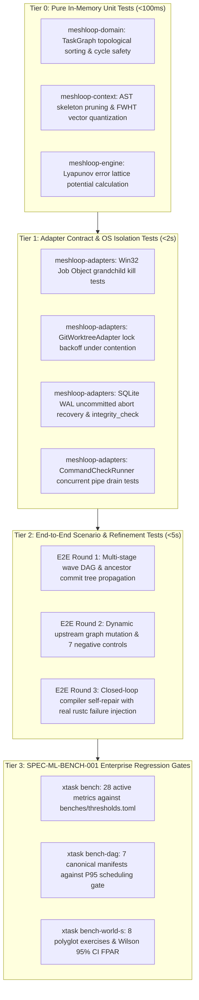

# Meshloop Testing & Verification Strategy

Meshloop's verification strategy rejects theatrical tests and mock success. Every capability is subject to multi-layered empirical verification, fault injection, and automated regression gates to ensure host safety, mathematical convergence, and zero workspace pollution.

---

## 1. Test Architecture & Verification Tiers

Verification is organized into four hierarchical tiers:



---

## 2. Test Execution Commands

All verification is orchestrated via `xtask` subcommands to maintain identical behavior across local developer workstations and CI/CD pipelines:

### 2.1 Standard Development Check (`xtask check`)
Runs code formatting checks, Clippy with all warnings denied (`-D warnings`), and executes all 142+ unit and integration tests across the workspace:
```bash
cargo run -p xtask -- check
```

### 2.2 Canonical SPEC-ML-BENCH-001 Gate (`xtask bench`)
Evaluates all 28 metrics against [`benches/thresholds.toml`](../../benches/thresholds.toml), generating a structured scorecard at `artifacts/bench/run.json`:
```bash
cargo run --release -p xtask -- bench
```
*Fail-closed rule:* An invariant miss exits 1. A missing smoke artifact exits 1. A performance-only miss exits 0 while `status.thresholds` is `fail` and the scorecard records the miss. `xtask check` and `xtask smoke` still fail their own commands.

`cargo run -p xtask -- bench-system1` reads [`benches/system1-thresholds.toml`](../../benches/system1-thresholds.toml). `xtask bench` still reads [`benches/thresholds.toml`](../../benches/thresholds.toml).

### 2.3 DAG Manifest Latency Benchmarks (`xtask bench-dag`)
Tests scheduler and topological sorting overhead using `hdrhistogram` across 7 canonical manifests in `benches/manifests/`:
```bash
cargo run -p xtask -- bench-dag
```
Evaluates:
- `chain.json` (deep linear dependency)
- `diamond.json` (fan-out and fan-in)
- `wide-fanout.json` (1 root to 16 parallel workers)
- `wide-fanin.json` (16 parallel workers to 1 sink)
- `forest.json` (multiple disjoint trees)
- `nested-diamond.json` (hierarchical pipeline)
- `cyclic-negative-control.json` (verified cycle rejection)

### 2.4 Opt-in Polyglot Autonomy Benchmark (`xtask bench-world-s`)
Runs 8 curated polyglot programming exercises (`rust-two-fer`, `rust-clock`, `ts-bob`, `py-luhn`, `go-hamming`, `cs-nucleotide-count`, `php-gigasecond`, `cpp-reverse-string`) to calculate the First-Pass Acceptance Rate (FPAR) with analytical 95% Wilson confidence intervals:
```bash
cargo run -p xtask -- bench-world-s
```

### 2.4a Learning-plane baseline (`xtask bench-learning`, live, manual)
Issue #144 fixes the task set and configuration that the learning-plane comparison (#140) is measured against. Everything is in [`benches/learning-plane/`](../../benches/learning-plane/): `taskset.json` (version `lp-4`, with the tier a plan reviewer sets for each task), eight tasks with a seed, hidden tests, a reference solution and the list of files a worker may edit, `verify.py` (tests a tree built from the pristine seed, the worker's editable files and the hidden tests, with Python run isolated, so edited tests or shadowing modules such as `unittest.py` or `sitecustomize.py` cannot pass a task; a pass needs a result line carrying a nonce (Python) or cargo test summaries adding up to the expected count (Rust), not a bare exit 0), and `meshloop.toml` (codex, claude and pi with two models each). Results and proposed thresholds are in [`BASELINE.md`](../../benches/learning-plane/BASELINE.md). lp-1 to lp-3 are kept as superseded records. The worker's code runs inside the test process, so these checks hold for cooperative workers. They are not a security boundary against code that deliberately tampers with the test framework from inside that process.

```bash
# Offline: each seed fails, each reference passes, and tamper cases (shadowing modules, edited tests) fail
cargo run -p xtask -- bench-learning --validate
# Live: uses harness quota; one disposable repository per task and repetition
cargo run -p xtask -- bench-learning --live --reps 3 --bin <meshloop> --bin-commit <sha> \
  --out .agent-runs/bench-learning/<name> --results benches/learning-plane/results/<name>.json
# Recompute the summary of a results file
cargo run -p xtask -- bench-learning --aggregate <results.json>
```

`--live` dispatches real workers and is never run by `xtask check`, `cargo test` or CI. Each run follows a fixed protocol (`review-plan --accept`, `run`, `resume --retry` while the node is `Failed` and attempts remain, `accept` only when Meshloop's checks passed, `resume`, `integrate --into main`), and success is the exit code of the hidden tests on `main`. Every task and repetition starts from a new repository and an empty Meshloop store, so no `routing_feedback` carries over. The runner stops early when a worker or Meshloop's quota breaker reports a usage limit. Token counts are taken only from what a harness prints (codex `tokens used`, claude `--output-format json`); otherwise they are recorded as not reported.

### 2.5 Full-Lifecycle Smoke Test (`xtask smoke`)
Validates the complete product lifecycle (`doctor` $\to$ `review-plan` $\to$ `run` $\to$ `accept` $\to$ `resume` $\to$ `integrate`) on a disposable Git repository in **<5 seconds**:
```bash
cargo run -p xtask -- smoke
```
The same command then runs the workspace lifecycle scenario on a separate disposable repository: inventory, cleanup preview, adoption preview, a stale digest, verified adoption, and maintenance preview, including a protected-data file that must remain. That scenario is outside the product-phase sum compared with `smoke.wall_clock_s`. The 5 second threshold is unchanged.

The WSL2 Tier A run of `check`, `live`, and `smoke`, including process-group cancellation and `.git/index.lock` behavior, is recorded in [evidence/issue-20/README.md](evidence/issue-20/README.md).

### 2.6 Packaging & Crate Isolation Check (`xtask publish-dry`)
Packages all five publishable crates (`meshloop-domain`, `meshloop-context`, `meshloop-engine`, `meshloop-adapters`, `meshloop-cli`) in strict offline isolation:
```bash
cargo run -p xtask -- publish-dry
```

### 2.7 Optional nodecode cell (`cells/nodecode-meshloop`)
The read-only nodecode cell (ADR 0038, #135) is Common Lisp, and the workspace never builds it. It is tested at two levels:

- **Blocking, offline contract.** [`cells/nodecode-meshloop/contract.json`](../../cells/nodecode-meshloop/contract.json) names every `--json` field the cell reads. `crates/meshloop-cli/tests/nodecode_cell_contract.rs` runs `doctor`, `status` and `inspect` on a fixture repository with the cell's arguments and asserts each field and its type. It runs inside `cargo test --workspace --locked --offline`, needs no nodecode and opens no socket. The cell checks every answer against the same file.
- **Load test, non-blocking.** `cells/nodecode-meshloop/test/load_test.py` loads the cell into `nodecode serve` on a throwaway `HOME` and runs the commands through the gateway, with no model turn. It checks the summaries, the one-line failures and that nothing in the repository or `.meshloop/` changed. It also checks that switching the cell off leaves meshloop's answers unchanged. The `nodecode-cell` CI job runs it on Linux with `continue-on-error`; `xtask` never calls it. Usage is in the [cell README](../../cells/nodecode-meshloop/README.md#tests).

---

## 3. Real Fault Injection & Negative Controls

Meshloop's test suite includes active negative controls to prove that security boundaries and state machines cannot be bypassed:

### 3.1 Process-Tree Ownership (Windows Job Objects)
- **Grandchild Elimination Test (`tests/process_tree.rs`):** Spawns a PowerShell process that in turn spawns child and grandchild worker processes. Cancelling the parent immediately terminates all descendants. Verified: `conc.orphan_process_count = 0`.
- **Parent Abort Test:** Simulates an unexpected parent process crash (`std::process::abort()`). The Windows kernel automatically kills all child processes attached to the Job Object.

### 3.2 Dynamic Graph Mutation Rollback Verification
Injects 7 distinct illegal mutations during live execution to verify that state rollbacks are 100% atomic:
1. Cycle injection (introducing directed loops).
2. Dangling dependency target (referencing non-existent task ID).
3. Duplicate task ID.
4. Reserved task ID 0.
5. Active state violation (mutating nodes currently executing in a worker).
6. Missing source node in followup chain.
7. Empty task list injection.

Each injection asserts that the post-rollback state strictly matches the pre-mutation baseline:
$$S = (\text{plan\_json}, \text{plan\_sha256}, \text{plan\_state}, \text{event\_count}, \text{integrity} == \text{"ok"})$$

### 3.3 Closed-Loop Compiler Self-Repair Failure Injection
- **Monotonic Convergence:** Injects type errors; verifies that repair rounds decrease error potential ($\Delta\Phi < 0$).
- **Syntax Regression Rollback:** Injects an unclosed delimiter (`error: this file contains an unclosed delimiter`); verifies that the engine triggers `git reset --hard` to restore the last clean commit and re-invokes with a negative constraint.
- **Oscillation Detection:** Injects alternating error states; verifies that the engine detects repeated diagnostic fingerprints and terminates deterministically without burning API budget.
